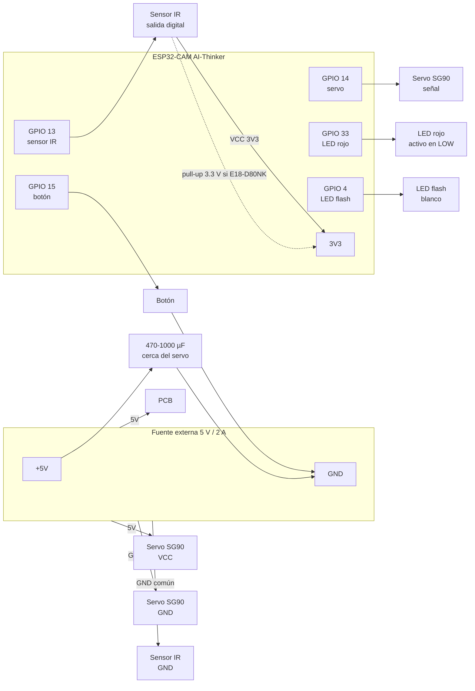

# ResiData - Cableado del Nodo IoT

Conexiones físicas del nodo de clasificación: **ESP32-CAM AI-Thinker** +
servomotor **SG90** + sensor de proximidad IR + botón manual.

> **ADVERTENCIA:** el firmware de este módulo está marcado como
> `ESTADO: NO VERIFICADO EN HARDWARE`. Antes de energizar el montaje real
> consulte `docs/pruebas_hardware.md` y alimente la placa por la fuente
> externa de 5 V (no por el puerto USB del ESP32-CAM-MB).

---

## 1. Resumen de conexiones

| Elemento | Señal | Pin ESP32-CAM | Alimentación | GND |
| --- | --- | --- | --- | --- |
| Servo SG90 | Señal (naranja) | GPIO 14 | 5 V fuente externa | GND común |
| Servo SG90 | Alimentación (rojo) | — | 5 V fuente (NO 3V3) | — |
| Servo SG90 | GND (marrón) | — | — | GND común |
| Sensor IR (FC-51 / E18-D80NK) | Salida digital | GPIO 13 (interrupción FALLING) | 3V3 | GND |
| Sensor IR (si E18-D80NK, colector abierto) | — | pull-up a 3.3 V | 3V3 | GND |
| Botón manual | Un extremo | GPIO 15 (INPUT_PULLUP) | — | — |
| Botón manual | Otro extremo | GND | — | GND |
| LED flash blanco | Ánodo/+ | GPIO 4 (integrado) | interno | interno |
| LED rojo | Activo en LOW | GPIO 33 (integrado) | interno | interno |
| Base ESP32-CAM-MB | USB 5 V | puerto micro-USB | 5 V (solo datos o +5V) | GND |

### Cámara OV2640 (pines internos fijos de la placa AI-Thinker)

No requieren cableado: son el trazado interno de la placa.

| Señal | Pin | Señal | Pin |
| --- | --- | --- | --- |
| PWDN | 32 | Y9 | 35 |
| RESET | -1 | Y8 | 34 |
| XCLK | 0 | Y7 | 39 |
| SIOD | 26 | Y6 | 36 |
| SIOC | 27 | Y5 | 21 |
| VSYNC | 25 | Y4 | 19 |
| HREF | 23 | Y3 | 18 |
| PCLK | 22 | Y2 | 5 |

---

## 2. Alimentación (IMPORTANTE)

- **Fuente externa de 5 V / 2 A mínimos.** El arranque del módulo WiFi +
  cámara + flash + servo supera con holgura lo que entrega el puerto USB.
- **Servo SIEMPRE a 5 V de la fuente externa.** Nunca al pin `3V3`.
- **GND común**: fuente, ESP32-CAM y servo deben compartir masa.
- Colocar un **capacitor electrolítico de 470–1000 µF** entre 5 V y GND
  **cerca del servo** (el calentón de arranque del SG90 produce picos que
  provocan *brownout* y reinicios).
- Si se observa `Brownout detector was triggered`, la fuente es insuficiente.

### Pines PROHIBIDOS (no conectar nada)

| Pin | Motivo |
| --- | --- |
| GPIO 0 | XCLK de la cámara y puesta en modo de programación |
| GPIO 2 y 12 | Pines *strapping* del ESP32 |
| GPIO 16 | PSRAM |
| GPIO 1 y 3 | UART de depuración |

---

## 3. Diagrama de conexiones

---

## 4. Notas de montaje

- **Sensor E18-D80NK (colector abierto):** requiere una resistencia
  *pull-up* a **3.3 V** (≈10 kΩ). Nunca conecte 5 V a GPIO 13.
- **FC-51:** salida digital con comparador (potenciómetro de alcance). El
  firmware dispara en flanco **FALLING**: verifique en placa si la salida cae
  a nivel bajo al detectar obstáculo en el rango y ajuste el potenciómetro
  si es necesario.
- **Antena WiFi** de la ESP32-CAM: el conector U.FL está en la placa; si
  usa antena exterior verifique el puente cerámico/ipx correcto.
- El LED rojo integrado es **activo en LOW** (se enciende con nivel bajo).