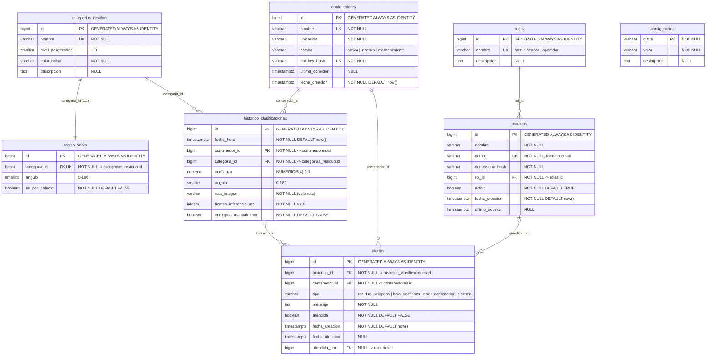

# ResiData - Diagrama Entidad-Relación

Diagrama del modelo relacional de la base de datos PostgreSQL de ResiData.

## Diagrama Mermaid

## Relaciones principales

| Relación | Cardinalidad | Regla de borrado |
| --- | --- | --- |
| `roles` → `usuarios` | 1 : N | `RESTRICT` |
| `categorias_residuo` → `reglas_servo` | 1 : 1 | `CASCADE` |
| `categorias_residuo` → `historico_clasificaciones` | 1 : N | `RESTRICT` |
| `contenedores` → `historico_clasificaciones` | 1 : N | `RESTRICT` |
| `historico_clasificaciones` → `alertas` | 1 : N | `RESTRICT` |
| `contenedores` → `alertas` | 1 : N | `RESTRICT` |
| `usuarios` → `alertas` (`atendida_por`) | 1 : N (opcional) | `SET NULL` |

## Notas

- Todas las claves primarias usan `GENERATED ALWAYS AS IDENTITY`.
- Todas las fechas son `TIMESTAMPTZ`.
- `configuracion` es una tabla clave/valor independiente (sin relaciones).
- La vista `vw_historico_detalle` desnormaliza `historico_clasificaciones` + `categorias_residuo` + `contenedores`.
